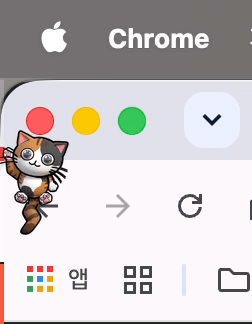

# NudgeLine

<p align="center">
  
</p>

<p align="center">
  <strong>静卧于屏幕边缘的今日时光线</strong><br>
  <em>macOS 15+ (Sequoia) / Swift 6, SwiftUI</em>
</p>

<p align="center">
  <a href="README.md">English</a> | <a href="README_KR.md">한국어</a> | <a href="README_JP.md">日本語</a> | <strong>简体中文</strong> | <a href="README_TW.md">繁體中文</a> | <a href="README_RU.md">Русский</a> | <a href="README_NL.md">Nederlands</a> | <a href="README_FR.md">Français</a> | <a href="README_DE.md">Deutsch</a> | <a href="README_ES.md">Español</a>
</p>

<p align="center">
  
  
  
  
</p>

---

## 为什么选择 NudgeLine？

在 32 位 macOS 时代，开发者曾非常钟爱一款经典的时间管理工具 [PixelScheduler](https://pixelscheduler.art-mixture.com/)。然而随着 macOS 全面转向 64 位，该应用的开发不得不画上了句号。怀揣着这份怀念与期待，NudgeLine 应运而生——它是为现代 macOS 打造的原生全新力作。

它继承了原作极简的屏幕边框日程线条概念，同时融入了鼠标靠近时会机灵躲藏的桌面宠物、细腻丰富的开始特效，以及对现代视频会议和 Apple“提醒事项”的深度原生整合，带来既实用又治愈的桌面体验：

- **无感环境型时间线 (Zero Interference)**: 紧贴屏幕边框，以 1–10px 的极窄色彩线条安静呈现。无需打开笨重的日历窗口，即可自然感知一天中时间的流逝。线条以外区域的鼠标点击和滚动会 100% 穿透至下方的应用程序（浏览器、代码编辑器等），绝不打断您专注的工作流。
- **一键生产力直达 (1-Click Productivity Bridge)**: 深度支持 Google Meet、Zoom、Microsoft Teams、FaceTime 等 11 大主流视频会议平台，一键瞬时入会；自动解构企业安全重定向链接（Microsoft Defender SafeLinks、Google Redirects）还原纯净直达链接；更无缝识别备忘中的 Notion、Slack、Things、Obsidian 等 10 大生产力应用深度链接，配以精致的原生专属徽标。
- **温和优雅的感官反馈 (Calm Sensory Feedback)**: 日程开始前 5–20 分钟，时间线会以轻柔优雅的微脉冲呼吸动画提醒您即将到来的日程。鼠标靠近时，陪伴在屏幕边缘的可爱宠物（三花猫、白色珍岛犬、白虎）会自然躲入边框身后；在需要全神贯注时，只需点击即可开启小憩暂停（Snooze）。
- **100% 纯原生与极致隐私 (Zero Overhead & Absolute Privacy)**: 零第三方外部依赖库，基于纯正 SwiftUI、AppKit 和 EventKit 构建，闲置内存占用低于 25MB，能耗极低。零外部网络通信，您的所有日程与提醒事项均在 Mac 本地安全内存中完成处理。

<div align="center">
  <video src="https://github.com/user-attachments/assets/63386ef2-a62a-44bb-a629-badb966f11a5" width="85%" controls></video>
</div>

<p align="center">
  &nbsp;&nbsp;&nbsp;&nbsp;
  &nbsp;&nbsp;&nbsp;&nbsp;
  <br>
  <em>当鼠标指针靠近时，桌面宠物会机灵地躲至屏幕边框后或渐隐消失（支持 6 种躲避动作）。</em>
</p>

---

## 安装与初始化指南

### 1. 通过 Homebrew 安装 (推荐)

在终端中执行以下单行命令即可便捷完成安装：

```bash
brew install rareram/tap/nudgeline
```

更新至最新版本：
```bash
brew upgrade rareram/tap/nudgeline
```

---

### 2. 直接下载 DMG 镜像安装

1. 前往 [GitHub Releases](https://github.com/rareram/NudgeLine/releases) 下载 `NudgeLine.dmg`，并将 `NudgeLine.app` 拖入 `/Applications`（应用程序）文件夹中。
2. 后续更新版本可通过菜单栏图标的 **[检查更新…]** 菜单实现一键应用内静默升级。

---

### 3. 首次启动权限与安全须知

NudgeLine 目前处于开源发布阶段，首次运行时需进行 macOS 标准的系统权限确认：

1. **Gatekeeper 安全提示确认 (仅首次启动)**:
   - 由于未包含商业开发者证书，首次启动时可能会弹出安全拦截提示。
   - 在“应用程序”文件夹中对 `NudgeLine.app` **右键 (或按住 Control 点击) > 选择 [打开]**，或在终端中运行：
     ```bash
     xattr -cr /Applications/NudgeLine.app
     ```
2. **日历与提醒事项访问权限 (TCC)**:
   - 首次启动时会弹出系统提示，请求读取日程和提醒事项以渲染时间线。
   - 您可随时在 **系统设置 > 隐私与安全性 > 日历 / 提醒事项** 中审查和管理权限状态。
3. **Apple Events 联动权限**:
   - 当点击悬浮卡片在官方“日历”应用中跳转至特定日期时，系统可能会请求授予 Apple Events 权限。
4. **完全本地化隐私保障**:
   - NudgeLine 绝不包含任何用户追踪、行为分析或外部数据回传代码。所有数据仅在您个人的 Mac 本地安全运行。

---

## 核心特性详解

### 1. 屏幕边缘时间线
- **自由布局**: 支持停靠在屏幕的左侧、右侧或底部边缘。
- **多显示器支持**: 仅在主显示器显示，或在所有连接的屏幕上同步呈现。
- **自定义粗细与悬停展开**: 默认厚度可在 1–10px 之间微调，并可开启鼠标悬停时优雅展开加粗效果。
- **已结束日程淡化**: 过去的日程将自动降低不透明度与饱和度（35%），鼠标悬停时瞬时恢复原色。
- **重叠日程呼吸流转**: 同一时段内的多个重叠日程，摒弃杂乱的斜纹斑马线，采用丝滑优雅的呼吸交叉淡入淡出（Cross-fade）动画展示。
- **时间指示器**: 提供三角刻度、圆顶、凸起色块、圆环 4 种造型与霓虹光晕效果。

### 2. 交互式悬浮气泡与快捷动作
- **操作卡片**: 鼠标悬停在时间线色块上，即可完整查看日程标题、时间、地点、备忘录以及一键会议接入按钮。
- **0ms 极速响应**: 剔除冗余视图层级包装，提供毫无卡顿与抖动的即时悬停渲染体验。
- **高对比度自适应**: 深色模式与浅色模式下均符合 WCAG 标准，确保清晰舒适的文本阅读体验。
- **智能汇整时间线外日程**: 精确提炼全天日程及超出设定工作时间范围的日程项（例如：`全天: 产品研讨会 · 时间线外 2 项 (21:00)`）。

### 3. 桌面宠物伴侣与物理微动效
- **3 款精美内置宠物**: 三花猫、白色珍岛犬、白虎（均包含 16 帧手工像素逐帧动画）。
- **6 种灵动躲避动作**:
  - `tailPeek`: 身体隐蔽于边框后，仅俏皮地摇晃尾巴。
  - `headPeek`: 身体隐藏，仅探出小脑袋和双眼张望。
  - `pop`: 缩小并如气泡般“啵”一声轻巧消失。
  - `vortex`: 伴随漩涡优雅旋转渐隐。
  - `squish`: 如果冻般贴着边框扁平压缩躲避。
  - `smoke`: 如轻烟般柔和虚化渐隐。
- **自定义逐帧宠物**: 支持直接拖入个人的 PNG 动画帧序列，并可在设置面板中实时调节 FPS 与边缘偏移。
- **宠物小憩 (Snooze)**: 点击时间指示器或悬浮气泡，宠物即可静默隐退；伴有微弱柔和的呼吸光晕与水波倒计时进度显示。

### 4. 时间线集成 Apple“提醒事项”
- **精确定位标记**: 将今日到期或指定具体时间的提醒事项精准锚定在时间轴上。
- **两类标记样式**:
  - **SF Symbols 符号**: 旗标、菱形、爱心、星形（保持列表专属主题色）。
  - **专属美食点心**: 适配宠物的精致小点心（小猫的小鱼、小狗的骨头、白虎的肉块）。
- **快捷清单交互**: 无需唤起“提醒事项”主程序，直接在悬浮卡片中勾选完成待办。

---

## 外部生态无缝联动

深度对接您日常工作中最常用的高频工具：

### 1. 视频会议接入 11 种 (1-Click Launch)
在日程卡片中一键瞬时入会：
- **全球与企业级**: Google Meet、Zoom、Microsoft Teams、Apple FaceTime、Cisco Webex、Amazon Chime。
- **协作办公与社区**: Discord、Lark (飞书海外版)、Whereby、Jitsi Meet。
- **区域服务**: NAVER Whale ON。
- **安全链接自动解包**: 智能解析剥离 Microsoft Defender SafeLinks 与 Google Redirects 重定向封装，直达真实目标网址，支持 Teams (`msteams://`) 和 FaceTime (`facetime://`) 协议直启。

### 2. 生产力工具与深度链接 10 种 + Web
自动识别日历和提醒事项备忘录中的工作链接并赋予专属高亮徽标：
- **知识库与协作**: Notion (`notion://`)、Slack (`slack://`)、Things 3 (`things://`)、Obsidian (`obsidian://`)、Bear (`bear://`)、Linear (`linear://`)、Figma (`figma://`)。
- **Apple 系统内置应用**: Apple 邮件 (`message://`)、备忘录 (`notes://`)、提醒事项 (`x-apple-reminderkit://`)。
- **标准 Web 链接**: 自动提取并展示整洁的域名主机名徽标（如：`github.com`、`docs.google.com`）。
- **三重安全防护**: 严格阻断恶意本地文件调用与脚本注入协议（`file`、`javascript` 等）。

### 3. 地图定位与导航 5 种
一键在您偏好的地图服务中查询日程地点：
- **支持服务**: Apple 地图、Google 地图、OpenStreetMap、NAVER 地图、Kakao 地图。
- **偏好设置**: 可在 **设置 > 通用 > 首选地图服务** 中自由切换。

---

## 快捷指令与菜单栏操作

- **菜单栏常驻控制**: 打开设置、立即刷新日程、检查版本更新、查看关于 NudgeLine。
- **原生信息面板**: 320pt 精巧卡片窗口，清晰展示版本信息、版本主要变更日志及官方支持链接。
- **macOS 快捷指令 (AppIntents) 支持**:
  - `刷新 NudgeLine 日程`: 在后台立即重新同步当天日历项。
  - `切换 NudgeLine 宠物`: 通过快捷指令快速显示或隐藏时间线上的桌面宠物。

---

## 构建与测试指南

### 系统要求
- macOS 15.0+ (Sequoia)
- Apple Silicon (M系列) 或 Intel 架构 Mac

### 从源码编译运行

```bash
# 1. 克隆代码仓库
git clone https://github.com/rareram/NudgeLine.git
cd NudgeLine

# 2. 构建本地开发调试版 (生成独立的 NudgeLine (Dev).app)
./scripts/build_app.sh
open "build/NudgeLine (Dev).app"

# 或构建正式发布版本
./scripts/build_app.sh --release
open "build/NudgeLine.app"
```

### 运行自动化单元测试

直接运行覆盖本地化字典、提醒解析器、日程切片算法及安全过滤器的完整单元测试套件（8 大测试套件，共 54 项测试）：

```bash
./scripts/run_tests.sh
```

---

## 项目架构一览

```
NudgeLine/
├── Sources/NudgeLine/
│   ├── Models/         # CalendarEvent, ReminderItem, AppSettings
│   ├── Services/       # CalendarService, ReminderService, Localization, UpdateService
│   └── Views/          # OverlayPanel, PopoverPanel, TimelineBarView, Settings/
├── Tests/NudgeLineTests/ # Swift Testing 单元测试套件
└── scripts/            # 打包脚本、DMG 生成工具、测试运行器、Git 钩子
```

---

## 多语言支持 (Localization)

NudgeLine 严格遵循 Apple macOS HIG 官方标准术语，原生支持以下 10 种语言环境：
- **系统默认** (自动跟随 macOS 系统首选语言)
- **简体中文**
- **English** (英语)
- **한국어** (韩语)
- **日本語** (日语)
- **繁體中文** (繁体中文)
- **俄语** (Русский)
- **荷兰语** (Nederlands)
- **法语** (Français)
- **德语** (Deutsch)
- **西班牙语** (Español)
此外，还隐藏着一种神秘的隐藏语言，等待在特定时刻或通过探索被唤醒。

您可以随时在 **设置 > 通用 > 语言** 中自由切换界面显示语言。

---

## 鸣谢与许可协议

- 本项目深受 Andreas Katzian 与 ARTMIXTURE 创作的经典工具 PixelScheduler (2014-2015) 设计理念启发，并以现代 macOS 技术进行了全新诠释。
- 许可协议: [MIT License](LICENSE)
- 版权所有: (c) 2026 rareram. All rights reserved.
