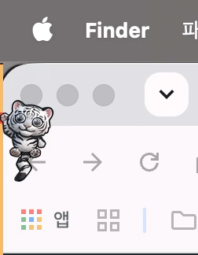

# NudgeLine

<p align="center">
  
</p>

<p align="center">
  <strong>Ihr Tagesablauf, dezent am Bildschirmrand platziert.</strong><br>
  <em>macOS 15+ (Sequoia) / Swift 6, SwiftUI</em>
</p>

<p align="center">
  <a href="README.md">English</a> | <a href="README_KR.md">한국어</a> | <a href="README_JP.md">日本語</a> | <a href="README_CN.md">简体中文</a> | <a href="README_TW.md">繁體中文</a> | <a href="README_RU.md">Русский</a> | <a href="README_NL.md">Nederlands</a> | <a href="README_FR.md">Français</a> | <strong>Deutsch</strong> | <a href="README_ES.md">Español</a>
</p>

<p align="center">
  
  
  
  
</p>

---

## Warum NudgeLine?

In der 32-Bit-Ära von macOS schätzte und nutzte der Entwickler täglich das klassische Dienstprogramm [PixelScheduler](https://pixelscheduler.art-mixture.com/). Nach dem Umstieg von macOS auf 64-Bit wurde dessen Entwicklung leider eingestellt. NudgeLine entstand aus dieser Sehnsucht: als moderner, nativer Nachfolger für das heutige macOS konzipiert.

Es greift das minimalistische Konzept einer Zeitleiste am Bildschirmrand auf und erweitert es um animierte Maskottchen, die Ihrem Mauszeiger ausweichen, feine visuelle Startereignisse und nahtlose Integrationen für moderne Videokonferenzen und Apple Erinnerungen:

- **Dezent & Störungsfrei (Zero Interference)**: Eine schmale Leiste von 1–10 px entlang des Bildschirmrandes hält Sie über Ihren Tag auf dem Laufenden, ohne dass Sie ein Kalenderfenster öffnen müssen. Mausklicks und Scrollen außerhalb der Leiste werden direkt an Ihren aktiven Arbeitsbereich (Browser, Code-Editoren) weitergeleitet, sodass Ihr Arbeitsfluss ungestört bleibt.
- **1-Klick-Produktivitätsbrücke**: Treten Sie Meetings auf 11 Plattformen (Google Meet, Zoom, Teams, FaceTime usw.) mit einem einzigen Klick bei, bereinigen Sie automatisch Sicherheitslinks von Unternehmen (SafeLinks, Google Redirects) und öffnen Sie Aufgaben-URLs (Notion, Slack, Things, Obsidian) mit nativen Badges.
- **Sanfte sensorische Hinweise**: Ein dezentes Pulsieren der Zeitleiste 5–20 Minuten vor Beginn erinnert Sie unaufdringlich an den nächsten Termin. Kleine animierte Maskottchen (Glückskatze, Weißer Jindo-Hund, Weißer Tiger) verstecken sich spielerisch hinter dem Bildschirmrand, sobald sich der Mauszeiger nähert.
- **100% nativ & Kompromissloser Datenschutz**: Ohne externe Abhängigkeiten in reinem SwiftUI, AppKit und EventKit entwickelt, mit einem Speicherbedarf von unter 25 MB im Ruhezustand. Völlig offline ohne externe Netzwerktelemetrie: Sämtliche Kalender- und Erinnerungsdaten werden ausschließlich im lokalen Arbeitsspeicher Ihres Mac verarbeitet.

<div align="center">
  <video src="https://github.com/user-attachments/assets/a3380d76-9313-4f39-83aa-e25fc015ea8e" width="85%" controls></video>
</div>

<p align="center">
  &nbsp;&nbsp;&nbsp;&nbsp;
  &nbsp;&nbsp;&nbsp;&nbsp;
  <br>
  <em>Animierte Maskottchen begleiten Ihren Arbeitstag und weichen dem Mauszeiger dezent hinter den Bildschirmrand aus (6 Versteck-Bewegungen unterstützt).</em>
</p>

---

## Installation & Einrichtung

### 1. Über Homebrew (Empfohlen)

```bash
brew install rareram/tap/nudgeline
```

So aktualisieren Sie auf die neueste Version:
```bash
brew upgrade rareram/tap/nudgeline
```

---

### 2. Direkter Download (.dmg)

1. Laden Sie `NudgeLine.dmg` von den [GitHub Releases](https://github.com/rareram/NudgeLine/releases) herunter und ziehen Sie `NudgeLine.app` in Ihren `/Applications`-Ordner.
2. Zukünftige Aktualisierungen können mit einem Klick über das Symbol in der Menüleiste installiert werden (**Nach Updates suchen…**).

---

### 3. Berechtigungen & Sicherheitshinweise

Da NudgeLine ein Open-Source-Projekt ist und nicht über den Mac App Store vertrieben wird, fordert macOS beim ersten Start Standardberechtigungen an:

1. **Gatekeeper-Sicherheitsbestätigung (nur beim ersten Start)**:
   - macOS zeigt möglicherweise einen Warnhinweis zu einem nicht identifizierten Entwickler an.
   - Klicken Sie mit der rechten Maustaste (oder Strg + Klick) auf `NudgeLine.app` in `/Applications` > wählen Sie **Öffnen**, oder führen Sie folgenden Befehl aus:
     ```bash
     xattr -cr /Applications/NudgeLine.app
     ```
2. **Zugriff auf Kalender und Erinnerungen (TCC)**:
   - Gewähren Sie beim Aufruf Zugriff auf **Kalender** und **Erinnerungen**, damit NudgeLine Ihren Zeitplan darstellen kann.
   - Sie können diese Berechtigungen jederzeit unter **Systemeinstellungen > Datenschutz & Sicherheit > Kalender / Erinnerungen** anpassen.
3. **Apple Events-Berechtigung**:
   - Wenn Sie auf ein Ereignis klicken, um die Apple Kalender-App an diesem Tag zu öffnen, bittet macOS möglicherweise um die Berechtigung für Apple Events.
4. **Keine Telemetrie garantiert**:
   - NudgeLine enthält **keinerlei Analyse-, Tracking- oder Netzwerk-Telemetriedienste**. Ihre Daten bleiben ausschließlich auf Ihrem Mac geschützt.

---

## Hauptfunktionen

### 1. Zeitleistenleiste am Bildschirmrand
- **Flexible Platzierung**: Verankern Sie die Leiste links, rechts oder am unteren Bildschirmrand.
- **Mehrere Bildschirme**: Auf dem Hauptbildschirm anzeigen oder auf allen angeschlossenen Displays spiegeln.
- **Anpassbare Dicke**: Standardbreite von 1 px bis 10 px, mit optionaler Vergrößerung beim Überfahren mit der Maus (Hover).
- **Abblenden vergangener Termine**: Abgeschlossene Ereignisse werden auf 35% Deckkraft und Sättigung abgeblendet und kehren beim Überfahren mit dem Mauszeiger in voller Farbe zurück.
- **Überlappende Termine**: Sanfte Überblendeffekte bei zeitgleichen Terminen.
- **Uhrzeit-Indikatoren**: Dreieck, Runde Kuppel, Vorstehender Block oder Punktring mit optionalem Neon-Leuchten.

### 2. Interaktive Popover & Sofortaktionen
- **Aktionskarten**: Zeigen Sie beim Überfahren eines Segments Titel, Uhrzeit, Ort, Notizen und die 1-Klick-Schaltfläche zur Konferenzteilnahme an.
- **Verzögerungsfreie Reaktion**: Sofortiges, ruckelfreies Einblenden ohne störende Ladezeiten.
- **Hoher Kontrast im Hell-/Dunkelmodus**: Automatische Anpassung von Text- und Schaltflächenkontrasten.
- **Übersicht außerhalb der Leiste**: Fasst ganztägige Termine und Ereignisse außerhalb des gewählten Zeitfensters zusammen (z. B. `3 außerhalb des Zeitbereichs (21:00)`).

### 3. Animierte Maskottchen & Physische Interaktionen
- **3 integrierte Begleiter**: Glückskatze, Weißer Jindo-Hund und Weißer Tiger (handgezeichnete Pixel-Animationen mit 16 Frames).
- **6 geschmeidige Versteck-Animationen**:
  - `tailPeek`: Versteckt den Körper hinter dem Rand, Schwanz wedelt.
  - `headPeek`: Versteckt den Körper, Kopf lugt neugierig hervor.
  - `pop`: Schrumpft und verschwindet mit einem Plopp-Effekt.
  - `vortex`: Rotiert in einem Wirbel heraus.
  - `squish`: Drückt sich flach an den Rand.
  - `smoke`: Löst sich sanft in Rauch auf.
- **Eigene Maskottchen**: Importieren Sie eigene PNG-Bildsequenzen mit einstellbarer Bildrate (FPS) und Offset-Anpassung.
- **Schlummermodus (Snooze)**: Klicken Sie auf den Zeitindikator oder Tooltip, um das Maskottchen vorübergehend auszublenden. Pulsierendes Leuchten mit flüssigem Wellen-Countdown.

### 4. Apple-Erinnerungen auf der Zeitleiste
- **Präzise Markierungen**: Heutige Erinnerungen mit festgelegter Uhrzeit erscheinen direkt auf der Zeitleiste.
- **Zwei Markierungsstile**:
  - **SF Symbols**: Flagge, Diamant, Herz oder Stern in der Farbe der jeweiligen Erinnerungsliste.
  - **Maskottchen-Leckerlis**: Passend zum gewählten Tier (Fisch für die Katze, Knochen für den Hund, Fleisch für den Tiger).
- **Interaktives Abhaken**: Erledigen Sie Aufgaben direkt in der Popover-Karte, ohne die Erinnerungen-App zu öffnen.

---

## Unterstützte Integrationen

NudgeLine bindet Ihre täglichen Werkzeuge direkt ein:

### 1. Videokonferenz-Plattformen (11 Plattformen)
1-Klick-Start aus der Terminkarte:
- **Enterprise & Global**: Google Meet, Zoom, Microsoft Teams, Apple FaceTime, Cisco Webex, Amazon Chime.
- **Zusammenarbeit & Communities**: Discord, Lark, Whereby, Jitsi Meet.
- **Regional**: Naver Whale ON.
- **SafeLinks & Native URL-Schemata**: Entfernt automatisch Schutz-Wrapper wie Microsoft Defender SafeLinks und Google Redirects und startet Teams (`msteams://`) sowie FaceTime (`facetime://`) direkt nativ.

### 2. Produktivitäts-Apps & Smart Deep Links (10 Apps + Web)
Eigene Badges für Aufgaben- und Projekt-URLs in Notizen und Erinnerungen:
- **Produktivität & Notizen**: Notion (`notion://`), Slack (`slack://`), Things 3 (`things://`), Obsidian (`obsidian://`), Bear (`bear://`), Linear (`linear://`), Figma (`figma://`).
- **Apple-System-Apps**: Apple Mail (`message://`), Apple Notizen (`notes://`), Apple Erinnerungen (`x-apple-reminderkit://`).
- **Webziele**: Aufgeräumte Hostnamen-Badges für Standard-Web-URLs (z. B. `github.com`, `docs.google.com`).
- **3-stufiger Sicherheitsfilter**: Blockiert riskante lokale Dateiausführungen und Skriptinjektionen (`file`, `javascript` usw.).

### 3. Kartendienste (5 Dienste)
Öffnen Sie Veranstaltungsorte in Ihrem bevorzugten Kartendienst:
- **Unterstützte Dienste**: Apple Karten, Google Maps, OpenStreetMap, Naver Map, Kakao Map.
- **Einstellbar**: Legen Sie Ihren Standarddienst fest unter **Einstellungen > Allgemein > Bevorzugter Kartendienst**.

---

## Kurzbefehle & Menüleiste

- **Menüleisten-Steuerung**: Schnellzugriff auf Einstellungen, Sofortige Aktualisierung, Update-Prüfung und Über NudgeLine.
- **Natives Info-Fenster**: Kompaktes 320-pt-Fenster mit Versionsangaben, Release-Höhepunkten und offiziellen Repository-Links.
- **macOS-Kurzbefehle (AppIntents)**:
  - `Refresh Schedule`: Zeitplan aus EventKit neu abfragen und aktualisieren.
  - `Toggle Mascot`: Sichtbarkeit des Maskottchens auf der Zeitleiste umschalten.

---

## Voraussetzungen & Kompilierung

### Voraussetzungen
- macOS 15.0+ (Sequoia)
- Apple Silicon oder Intel Mac

### Aus Quellcode kompilieren

```bash
# 1. Repository klonen
git clone https://github.com/rareram/NudgeLine.git
cd NudgeLine

# 2. Lokale Entwicklungsversion kompilieren
./scripts/build_app.sh
open "build/NudgeLine (Dev).app"

# Oder Produktions-Release erstellen
./scripts/build_app.sh --release
open "build/NudgeLine.app"
```

### Automatische Tests ausführen

Führen Sie die gesamte Testsuite aus (54 Tests in 8 Suiten), welche Lokalisierung, Erinnerungs-Parsing, Termin-Segmentierung und Sicherheitsfilter prüft:

```bash
./scripts/run_tests.sh
```

---

## Projektarchitektur

```
NudgeLine/
├── Sources/NudgeLine/
│   ├── Models/         # CalendarEvent, ReminderItem, AppSettings
│   ├── Services/       # CalendarService, ReminderService, Localization, UpdateService
│   └── Views/          # OverlayPanel, PopoverPanel, TimelineBarView, Settings/
├── Tests/NudgeLineTests/ # Unit-Testsuite mit Swift Testing
└── scripts/            # Skripte für Paketierung, DMG-Erstellung, Tests und Git-Hooks
```

---

## Lokalisierung (Localization)

NudgeLine unterstützt 10 Sprachen nativ gemäß den Apple macOS HIG-Richtlinien:
- **Systemstandard** (folgt der Systemsprache Ihres macOS)
- **Deutsch**
- **English** (Englisch)
- **한국어** (Koreanisch)
- **日本語** (Japanisch)
- **简体中文** (Vereinfachtes Chinesisch)
- **繁體中文** (Traditionelles Chinesisch)
- **Русский** (Russisch)
- **Nederlands** (Niederländisch)
- **Français** (Französisch)
- **Español** (Spanisch)

Sowie eine geheime Sprache, die zu besonderen Anlässen oder durch feine Interaktionen entdeckt werden kann.

Sie können die Anzeigesprache jederzeit unter **Einstellungen > Allgemein > Sprache** ändern.

---

## Danksagung & Lizenz

- Inspiriert durch das Konzept von PixelScheduler (2014-2015) von Andreas Katzian & ARTMIXTURE.
- Lizenz: [MIT-Lizenz](LICENSE).
- Urheberrecht: (c) 2026 rareram. Alle Rechte vorbehalten.
