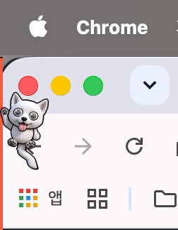

# NudgeLine

<p align="center">
  
</p>

<p align="center">
  <strong>El horario de hoy, con calma en el borde de tu pantalla.</strong><br>
  <em>macOS 15+ (Sequoia) / Swift 6, SwiftUI</em>
</p>

<p align="center">
  <a href="README.md">English</a> | <a href="README_KR.md">한국어</a> | <a href="README_JP.md">日本語</a> | <a href="README_CN.md">简体中文</a> | <a href="README_TW.md">繁體中文</a> | <a href="README_RU.md">Русский</a> | <a href="README_NL.md">Nederlands</a> | <a href="README_FR.md">Français</a> | <a href="README_DE.md">Deutsch</a> | <strong>Español</strong>
</p>

<p align="center">
  
  
  
  
</p>

---

## ¿Por qué NudgeLine?

En la era de macOS de 32 bits, el desarrollador confiaba y disfrutaba a diario de una utilidad clásica llamada [PixelScheduler](https://pixelscheduler.art-mixture.com/). Tras la transición de macOS a 64 bits, su desarrollo se detuvo desafortunadamente. NudgeLine nació de esa nostalgia: diseñado como un sucesor moderno y nativo para el macOS actual.

Hereda el concepto minimalista de una línea de tiempo en el borde de la pantalla, enriquecido con mascotas animadas que esquivan el cursor, efectos visuales de inicio de evento e integración fluida con plataformas modernas de videollamadas y Recordatorios de Apple:

- **Ambiente discreto y cero interferencias**: Una barra delgada de 1 a 10 px a lo largo del borde de la pantalla le mantiene al tanto de su jornada sin necesidad de abrir una ventana de calendario. Los clics y desplazamientos fuera de la barra pasan directamente a su espacio de trabajo activo (navegadores, editores de código), garantizando cero interrupciones en su flujo diario.
- **Puente de productividad en 1 clic**: Únase al instante a reuniones en 11 plataformas (Google Meet, Zoom, Teams, FaceTime, etc.), elimine automáticamente los enlaces de seguridad corporativos (SafeLinks, redirecciones de Google) y abra directamente enlaces de tareas (Notion, Slack, Things, Obsidian) con insignias nativas.
- **Retroalimentación sensorial sutil**: Una suave pulsación de la barra entre 5 y 20 minutos antes del inicio de una reunión le avisa discretamente. Pequeñas mascotas animadas (Gato calicó, Perro Jindo blanco, Tigre blanco) se ocultan juguetonamente detrás del borde de la pantalla cuando el cursor se acerca.
- **100% nativo y privacidad absoluta**: Construido sin dependencias externas en SwiftUI, AppKit y EventKit puros, con un consumo de memoria inferior a 25 MB en reposo. Sin telemetría de red externa: todos los datos del calendario y recordatorios se procesan exclusivamente en la memoria local de su Mac.

<div align="center">
  <video src="https://github.com/user-attachments/assets/a3380d76-9313-4f39-83aa-e25fc015ea8e" width="85%" controls></video>
</div>

<p align="center">
  &nbsp;&nbsp;&nbsp;&nbsp;
  &nbsp;&nbsp;&nbsp;&nbsp;
  <br>
  <em>Las mascotas animadas le acompañan con calma y se esconden tras el borde de la pantalla al acercarse el cursor (admite 6 movimientos).</em>
</p>

---

## Instalación y configuración

### 1. Vía Homebrew (Recomendado)

```bash
brew install rareram/tap/nudgeline
```

Para actualizar a la versión más reciente:
```bash
brew upgrade rareram/tap/nudgeline
```

---

### 2. Descarga directa (.dmg)

1. Descargue `NudgeLine.dmg` desde [GitHub Releases](https://github.com/rareram/NudgeLine/releases) y arrastre `NudgeLine.app` a su carpeta `/Applications`.
2. Las futuras actualizaciones se pueden instalar con un solo clic desde el icono de la barra de menús (**Buscar actualizaciones…**).

---

### 3. Permisos y aviso de seguridad

Dado que NudgeLine es un proyecto de código abierto y aún no se distribuye a través de la Mac App Store, macOS solicita permisos estándar del sistema en el primer inicio:

1. **Confirmación de seguridad de Gatekeeper (solo primer inicio)**:
   - macOS puede mostrar una advertencia de desarrollador no identificado.
   - Haga clic derecho (o Control + Clic) en `NudgeLine.app` dentro de `/Applications` > seleccione **Abrir**, o ejecute:
     ```bash
     xattr -cr /Applications/NudgeLine.app
     ```
2. **Acceso a Calendarios y Recordatorios (TCC)**:
   - Cuando se le solicite, conceda acceso a **Calendarios** y **Recordatorios** para que NudgeLine pueda mostrar su horario.
   - Puede revisar o revocar estos permisos en cualquier momento en **Ajustes del Sistema > Privacidad y seguridad > Calendarios / Recordatorios**.
3. **Permiso de Apple Events**:
   - Al hacer clic en un evento para abrir la aplicación Calendario de Apple en esa fecha específica, macOS puede solicitar permiso de Apple Events.
4. **Garantía de cero telemetría**:
   - NudgeLine contiene **cero análisis, rastreo o telemetría de red**. Sus datos permanecen estrictamente confidenciales en su Mac.

---

## Funciones principales

### 1. Barra de línea de tiempo en el borde de la pantalla
- **Ubicación flexible**: Fije la barra en el borde izquierdo, derecho o inferior de la pantalla.
- **Múltiples pantallas**: Muéstrela en su pantalla principal o duplíquela en todas las pantallas conectadas.
- **Grosor personalizable**: Grosor predeterminado de 1 px a 10 px, con expansión opcional al pasar el cursor (hover).
- **Atenuación de eventos pasados**: Los eventos concluidos se atenúan al 35% de opacidad y saturación, recuperando el color completo al pasar el cursor.
- **Horarios superpuestos**: Suaves transiciones de fundido cruzado para eventos simultáneos.
- **Indicadores de hora**: Triángulo, Domo redondo, Bloque saliente o Anillo puntual con brillo de neón opcional.

### 2. Tarjetas emergentes interactivas y acciones instantáneas
- **Tarjetas de acción**: Pase el cursor sobre cualquier segmento para ver título, hora, ubicación, notas y el botón de acceso en 1 clic a la reunión.
- **Respuesta instantánea**: Renderizado sin latencia ni tirones al pasar el cursor.
- **Alto contraste adaptable al tema**: Ajusta automáticamente el contraste del texto y los botones en modos Claro y Oscuro.
- **Contador inteligente fuera de la barra**: Resume ordenadamente los eventos de todo el día y los que quedan fuera del rango horario configurado (ej.: `3 fuera de rango (21:00)`).

### 3. Mascotas animadas e interacciones físicas
- **3 mascotas integradas**: Gato calicó, Perro Jindo blanco y Tigre blanco (animaciones pixeladas artesanales de 16 fotogramas).
- **6 movimientos de ocultamiento fluidos**:
  - `tailPeek`: Oculta el cuerpo detrás del borde, moviendo la cola.
  - `headPeek`: Oculta el cuerpo, asomando la cabeza con curiosidad.
  - `pop`: Se encoge y desaparece con efecto pop.
  - `vortex`: Rota desapareciendo en remolino.
  - `squish`: Se aplasta suavemente contra el borde.
  - `smoke`: Se desvanece suavemente en humo.
- **Mascotas personalizadas**: Importe sus propias secuencias de fotogramas PNG con control de FPS y ajuste de desplazamiento en vivo.
- **Pausa de mascota (Snooze)**: Haga clic en el indicador de hora o en la ayuda para ocultar temporalmente la mascota. Muestra un brillo pulsante y una cuenta atrás de onda líquida.

### 4. Recordatorios de Apple en la línea de tiempo
- **Marcadores precisos**: Muestra los recordatorios de hoy con hora asignada directamente sobre la barra de línea de tiempo.
- **Dos estilos de marcadores**:
  - **Símbolos SF**: Iconos de Bandera, Diamante, Corazón o Estrella con el color de su lista de recordatorios.
  - **Premios para mascotas**: Alimentos específicos según el animal elegido (Pescado para el gato, Hueso para el perro, Carne para el tigre).
- **Lista de tareas interactiva**: Marque recordatorios como completados directamente desde la tarjeta emergente sin abrir la app Recordatorios.

---

## Integraciones compatibles

NudgeLine se integra directamente con las herramientas que ya utiliza a diario:

### 1. Plataformas de videollamadas (11 plataformas)
Acceso en 1 clic desde la tarjeta emergente:
- **Corporativo y Global**: Google Meet, Zoom, Microsoft Teams, Apple FaceTime, Cisco Webex, Amazon Chime.
- **Colaboración y Comunidades**: Discord, Lark, Whereby, Jitsi Meet.
- **Regional**: Naver Whale ON.
- **SafeLinks y Esquemas nativos**: Desempaqueta automáticamente los enlaces seguros de Microsoft Defender y las redirecciones de Google, con inicio nativo mediante esquemas directos para Teams (`msteams://`) y FaceTime (`facetime://`).

### 2. Aplicaciones de productividad y enlaces profundos (10 apps + Web)
Insignias dedicadas para URL de proyectos y tareas en recordatorios y notas:
- **Productividad y Notas**: Notion (`notion://`), Slack (`slack://`), Things 3 (`things://`), Obsidian (`obsidian://`), Bear (`bear://`), Linear (`linear://`), Figma (`figma://`).
- **Apps del sistema Apple**: Apple Mail (`message://`), Notas (`notes://`), Recordatorios (`x-apple-reminderkit://`).
- **Destinos Web**: Insignias limpias con el nombre de host para URL estándar (ej.: `github.com`, `docs.google.com`).
- **Filtro de seguridad de 3 niveles**: Bloquea la ejecución peligrosa de archivos locales y scripts (`file`, `javascript`, etc.).

### 3. Servicios de mapas (5 servicios)
Abra la ubicación del evento en su servicio de mapas preferido:
- **Servicios compatibles**: Apple Mapas, Google Maps, OpenStreetMap, Naver Map, Kakao Map.
- **Configurable**: Seleccione su proveedor predeterminado en **Ajustes > General > Servicio de mapas preferido**.

---

## Atajos y controles en la barra de menús

- **Controles de la barra de menús**: Acceso rápido a Ajustes, Actualización instantánea, Buscar actualizaciones y Acerca de NudgeLine.
- **Ventana Acerca de nativa**: Ventana compacta de 320 pt con información de la versión, novedades destacadas y enlaces oficiales al repositorio.
- **Atajos de macOS (AppIntents)**:
  - `Refresh Schedule`: Volver a consultar EventKit y actualizar la línea de tiempo.
  - `Toggle Mascot`: Alternar la visibilidad de la mascota en la barra.

---

## Requisitos y compilación

### Requisitos
- macOS 15.0+ (Sequoia)
- Mac con chip Apple Silicon o procesador Intel

### Compilar desde el código fuente

```bash
# 1. Clonar el repositorio
git clone https://github.com/rareram/NudgeLine.git
cd NudgeLine

# 2. Compilar versión local de depuración
./scripts/build_app.sh
open "build/NudgeLine (Dev).app"

# O compilar versión final de producción
./scripts/build_app.sh --release
open "build/NudgeLine.app"
```

### Ejecutar pruebas unitarias

Ejecute la suite completa de pruebas automatizadas (54 pruebas en 8 suites) que cubren localización, procesamiento de recordatorios, segmentación de eventos y filtros de seguridad:

```bash
./scripts/run_tests.sh
```

---

## Arquitectura del proyecto

```
NudgeLine/
├── Sources/NudgeLine/
│   ├── Models/         # CalendarEvent, ReminderItem, AppSettings
│   ├── Services/       # CalendarService, ReminderService, Localization, UpdateService
│   └── Views/          # OverlayPanel, PopoverPanel, TimelineBarView, Settings/
├── Tests/NudgeLineTests/ # Suite de pruebas unitarias Swift Testing
└── scripts/            # Scripts de empaquetado, creador de DMG, pruebas y githooks
```

---

## Localización (Localization)

NudgeLine es compatible de forma nativa con 10 idiomas siguiendo estrictamente las directrices macOS HIG de Apple:
- **Predeterminado del sistema** (sigue el idioma configurado en su macOS)
- **Español**
- **English** (Inglés)
- **한국어** (Coreano)
- **日本語** (Japonés)
- **简体中文** (Chino simplificado)
- **繁體中文** (Chino tradicional)
- **Русский** (Ruso)
- **Nederlands** (Neerlandés)
- **Français** (Francés)
- **Deutsch** (Alemán)

Además de un idioma secreto que espera ser descubierto en ocasiones especiales o mediante sutiles interacciones.

Puede cambiar su preferencia de idioma en cualquier momento en **Ajustes > General > Idioma**.

---

## Créditos y licencia

- Inspirado en el concepto de PixelScheduler (2014-2015) de Andreas Katzian & ARTMIXTURE.
- Licencia: [Licencia MIT](LICENSE).
- Derechos de autor: (c) 2026 rareram. Todos los derechos reservados.
